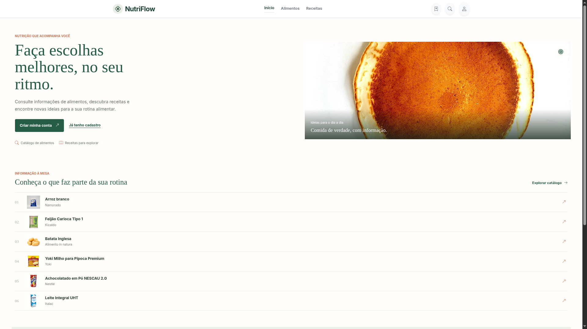
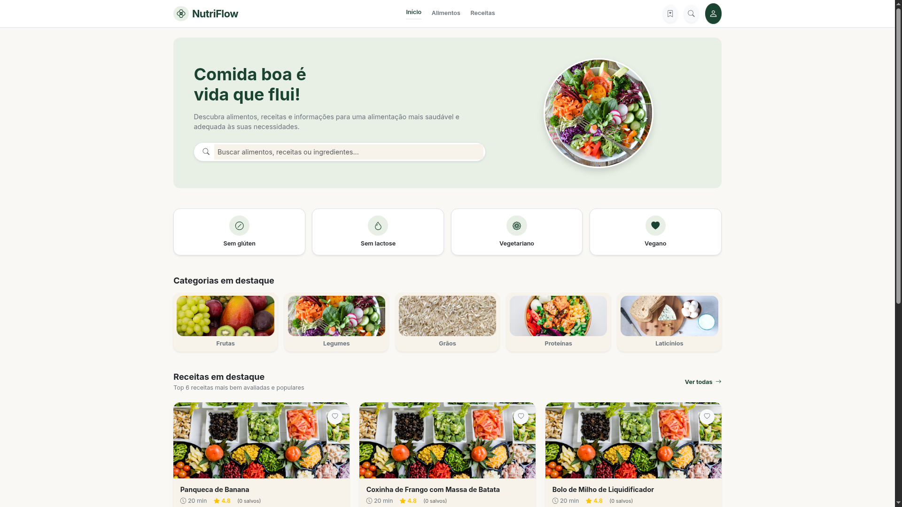
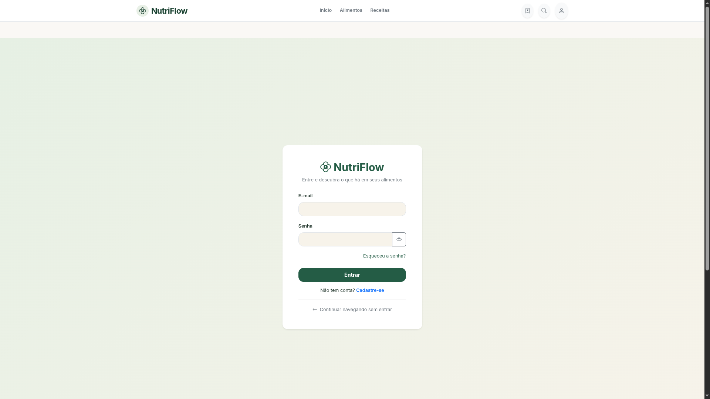
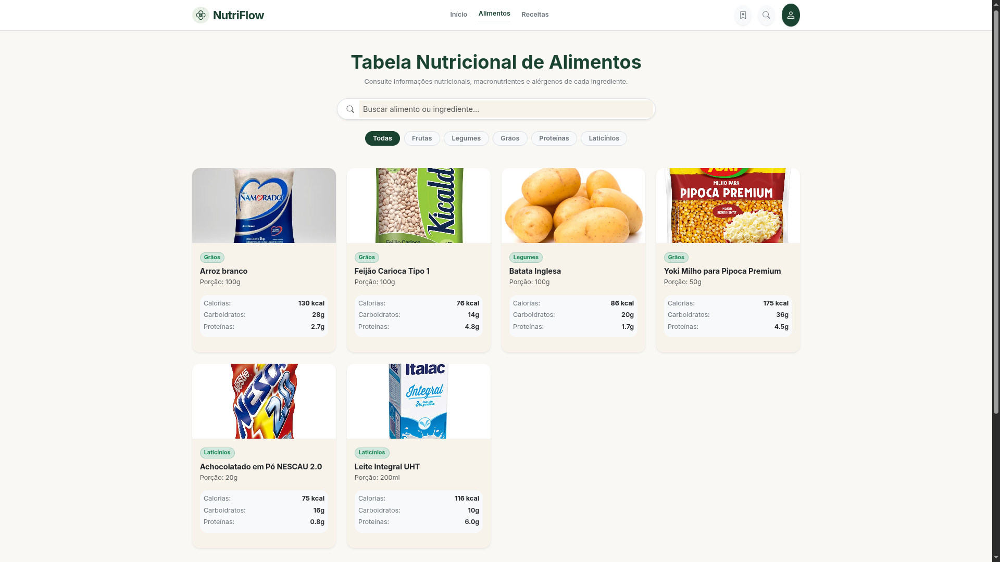
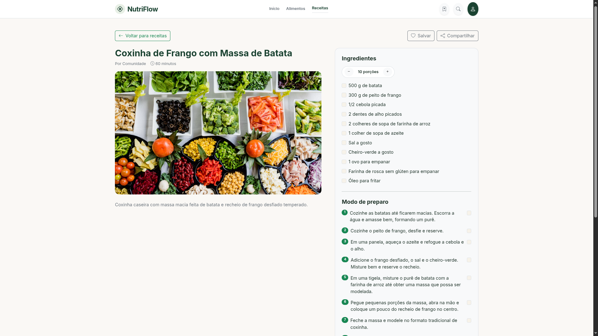
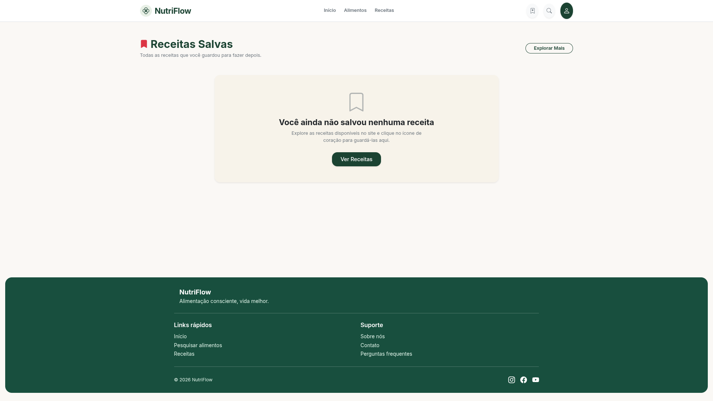

# React + Vite

This template provides a minimal setup to get React working in Vite with HMR and some ESLint rules.

Currently, two official plugins are available:


## React Compiler

# NutriFlow

O NutriFlow reúne informações nutricionais de alimentos e receitas em um só lugar. A aplicação ajuda a explorar ingredientes, consultar dados nutricionais e descobrir receitas para o dia a dia.

## Demonstração

As imagens abaixo mostram as principais telas da aplicação.

<div align="center">
	<table>
		<tr>
			<td align="center" width="50%">
				<strong>Início</strong><br>
				
			</td>
			<td align="center" width="50%">
				<strong>Área do usuário</strong><br>
				
			</td>
		</tr>
		<tr>
			<td align="center" width="50%">
				<strong>Entrar</strong><br>
				
			</td>
			<td align="center" width="50%">
				<strong>Alimentos</strong><br>
				
			</td>
		</tr>
		<tr>
			<td align="center" width="50%">
				<strong>Detalhes da receita</strong><br>
				
			</td>
			<td align="center" width="50%">
				<strong>Receitas salvas</strong><br>
				
			</td>
		</tr>
	</table>
</div>

## Recursos

- Pesquisa de alimentos por nome e categoria.
- Consulta de calorias, macronutrientes e informações sobre ingredientes.
- Exploração, avaliação e salvamento de receitas.
- Visualização de ingredientes, porções e etapas de preparo.
- Cadastro e acesso à conta.

## Tecnologias

- React 19
- Vite 8
- React Router
- Bootstrap e Bootstrap Icons

## Como executar

Pré-requisito: Node.js e npm instalados.

```bash
npm install
npm run dev
```

O Vite informa no terminal o endereço local para abrir a aplicação.

## Comandos disponíveis

```bash
npm run dev      # inicia o servidor de desenvolvimento
npm run build    # gera a versão de produção em dist/
npm run preview  # pré-visualiza a versão de produção
npm run lint     # executa o ESLint
```

## Organização

- `src/pages/`: páginas e fluxos da aplicação.
- `src/components/`: componentes reutilizáveis da interface.
- `src/data/`: dados iniciais de alimentos e receitas.
- `src/assets/`: logo e capturas de tela usadas nesta apresentação.
- `public/`: imagens servidas diretamente pela aplicação.
